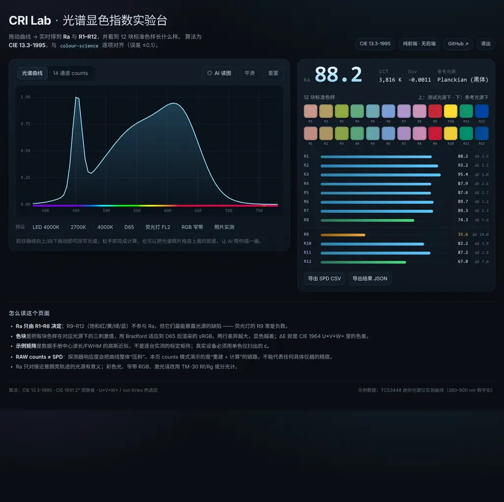

# CRI Lab — 光谱显色指数在线实验台

一个口令保护的单页：**拖动光谱曲线（或调 13 路通道计数）→ 实时算出 CIE 13.3-1995 的 Ra 与 R1–R12**，
并把 12 块标准色样在「测试光源 / 参考光源」下的颜色直接渲染成色块，肉眼就能看出显色好坏。

还可以**把光谱照片直接拖进图里**：由 magpie 网关上的多模态模型把曲线描出来，再交给你手工修正。

- 算法：CIE 13.3-1995，CIE 1931 2° 观察者，CIE 1964 U\*V\*W\* + von Kries 色适应
- 校验：与 `colour-science 0.4.7` 的 `colour_rendering_index` 逐项对齐，误差 ≤ 0.1
- 依赖：前端 0 依赖（无框架、无构建、无外链字体）；后端只有 Node 标准库
- 数据：**不落盘**。上传的图片只在内存里过一次 API，解析完即丢



## 页面里有什么

| 模块 | 说明 |
|---|---|
| 口令 | 一个共享口令，签发 HttpOnly Cookie（HMAC，无数据库、无会话表） |
| 光谱编辑器 | 抓住曲线上下拖动即改；7 个预设（白光 LED、2700K/4000K 黑体、D65、荧光灯 FL2、RGB 窄带、照片实测曲线） |
| **AI 读图** | 点按钮或把图片拖进图里 → `/api/ocr` → magpie 视觉模型 → 25 个点 → 插值成曲线，可继续拖动修正 |
| 14 通道 counts | 13 根滑杆 → `min‖C·w−n‖² + λ‖D₂·Mᵀw‖², w≥0`（Lawson–Hanson NNLS）反解 SPD，显示重建残差 |
| 实时结果 | Ra、CCT、Duv、参考光源类型、`|Duv|>0.0054` 的适用性警告 |
| 色块对比 | 上排＝测试光源下、下排＝参考光源下，Bradford 适应到 D65 后渲染 sRGB；每块附 ΔE |
| 明细 | R1–R12 条形图 + ΔE；R9–R12 单独分组（不参与 Ra） |
| 导出 | 当前 SPD → CSV；当前结果 → JSON |

## 算法

```
k   = 100 / Σ S(λ)·ȳ(λ)·Δλ          # 理想白板 Y=100，每个光源各自求一次
XYZ = k·Σ S·CMF·Δλ
u,v = 4X/(X+15Y+3Z), 6Y/(X+15Y+3Z)  # CIE 1960 UCS
T   = argmin_T ‖uv − uv_planck(T)‖  # 1000–100000 K
ref = T < 5000 ? Planck(T) : CIE D(T)
c = (4−u−10v)/v ; d = (1.708v+0.404−1.481u)/v
u_k = (10.872 + 0.404·(c_r/c_t)·c_k − 4·(d_r/d_t)·d_k) / (16.518 + 1.481·(c_r/c_t)·c_k − (d_r/d_t)·d_k)
v_k = 5.520 / 分母
W* = 25·Y^(1/3) − 17 ; U* = 13W*(u−u_r) ; V* = 13W*(v−v_r)
ΔE = √(ΔU*²+ΔV*²+ΔW*²) ; Rᵢ = 100 − 4.6·ΔE ; Ra = mean(R1…R8)
```

**坑**：不要把每块色样各自归一化到 Y=100 —— 那样 Ra 会从 64 掉到 43（FL2）。k 必须由光源求一次，色样共用。

### 校验

| 光源 | Ra | R9 |
|---|---|---|
| 黑体 2856 K (A) | 100.00 | 100.0 |
| D65 | 99.99 | 100.0 |
| FL2 | 64.16 | −83.9 |
| FL11 | 82.83 | 25.2 |
| 照片实测曲线（380–900 nm 数字化） | 88.68 | 48.5 |

## 配置

| 变量 | 必填 | 默认 | 说明 |
|---|---|---|---|
| `APP_SECRET` | ✅ | — | 进入页面的唯一口令；同时用于签 Cookie 的 HMAC |
| `MAGPIE_API_KEY` | ✅ | — | magpie 网关 key（`sk-magpie-…`，不用带 `Bearer ` 前缀） |
| `MAGPIE_BASE_URL` | | `https://magpie.answer42.xyz/v1` | OpenAI 兼容入口 |
| `MAGPIE_MODEL` | | `group/never-stuck` | 能读图的路由组/模型；也可填 `auto/gemini-3.8-flash` 等 |
| `MAX_IMAGE_MB` | | `6` | 单张图片上限 |
| `OCR_TIMEOUT_MS` | | `90000` | 上游超时 |

复制 `.env.example` 即可。**不要把真实值提交进仓库。**

## 本地运行

```bash
APP_SECRET=test123 MAGPIE_API_KEY=sk-magpie-xxxx node server.js
# 打开 http://127.0.0.1:8080 -> 输入 test123
```

Docker：

```bash
docker build -t cri-demo .
docker run --rm -p 8080:80 -e APP_SECRET=test123 -e MAGPIE_API_KEY=sk-magpie-xxxx cri-demo
```

## 部署到 Dokploy

1. Dokploy → **Create Application** → GitHub 仓库 `Dakai/cri-demo`，Build Type **Dockerfile**（或 Compose，用仓库里的 `docker-compose.yml`）。
2. **Environment** 填 `APP_SECRET`（自定口令）和 `MAGPIE_API_KEY`（magpie 后台 → gateway keys 里的 `cri-demo` key）。
   可选 `MAGPIE_MODEL`。
3. **Domains** → Add Domain：
   - Host：`cri.oudakai.dev`
   - Service：`web`（Compose）或容器（Dockerfile 应用）
   - Container Port：`80`
   - 勾选 **HTTPS** + **Let's Encrypt**
4. Deploy。健康检查端点 `/healthz`。

DNS 已就绪：`cri.oudakai.dev A 212.47.68.180`（DNS only，Traefik 自己签证书）。

## 目录

```
server.js          静态服务 + 口令 + /api/ocr（Node 标准库，无依赖）
public/index.html  页面结构
public/login.html  口令页
public/style.css   主题（深色、无外链字体）
public/app.js      UI / 画布 / 交互 / AI 读图
public/cri.js      CIE 13.3-1995 核心 + NNLS + sRGB 渲染（浏览器与 node 共用）
public/data.js     CIE 1931 2° CMF、14 块色样反射比、D 系列基函数（5 nm / 380–780）
Dockerfile         node:22-alpine
docker-compose.yml
.env.example
```

## 隐私

- 图片只在内存中编码成 data URL 转发给 magpie，然后即弃；没有磁盘、没有数据库、没有日志留存（日志只记点数和耗时）。
- 口令只用于签发 Cookie，服务端不存任何用户记录。
- 退出按钮会清掉 Cookie。

## 限制（页面上也写着）

- **示例矩阵是数据手册中心波长/FWHM 的高斯近似**，不是逐台实测的标定矩阵；真实设备的 `C` 必须用单色仪扫。
- **RAW counts ≠ SPD**：探测器响应度会把曲线整体压斜。对同一束光，去掉响应度后 CCT 从 5623 K 变到 7735 K，而 Ra 只从 88.7 到 89.4。
- AI 读图是「描点」不是「测量」：它按视觉估计曲线形状，**不能替代数字化**；好在结果可以直接拖动修正。
- Ra 只对接近普朗克轨迹的光源有效（|Duv| ≲ 0.0054）；彩色光、窄带 RGB、激光请用 TM-30 Rf/Rg 或分光计。
